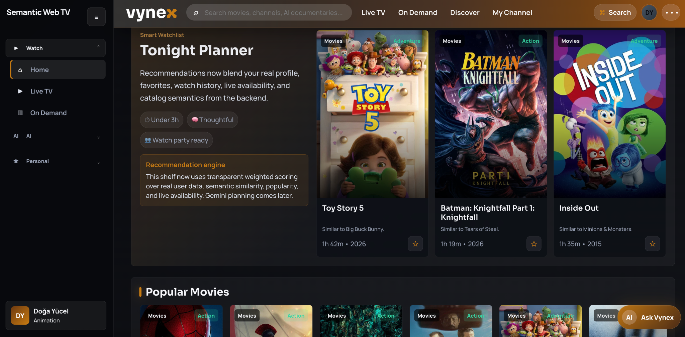
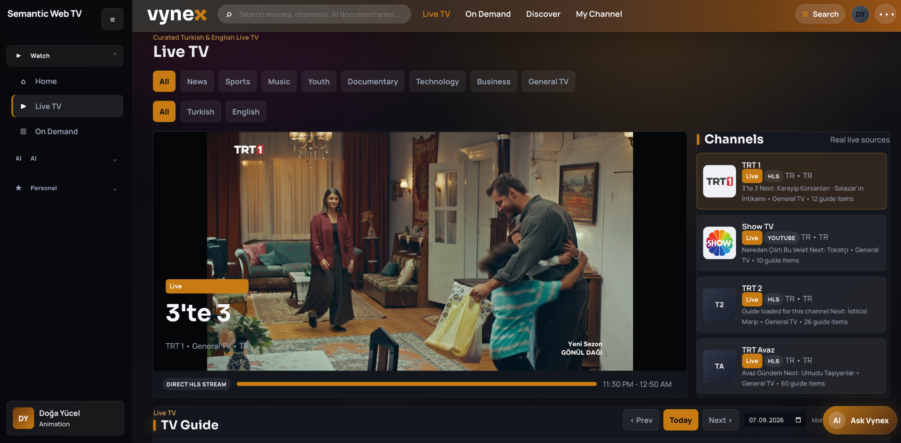
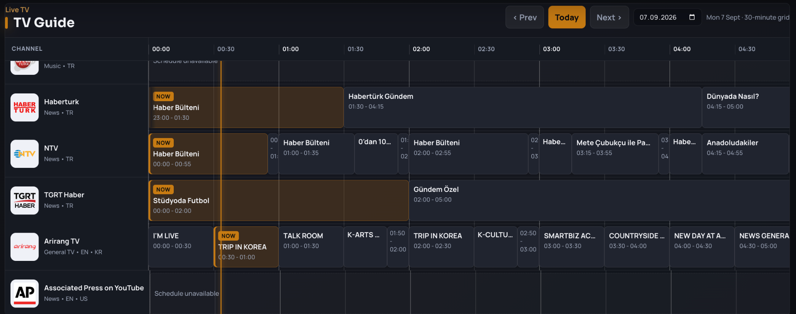
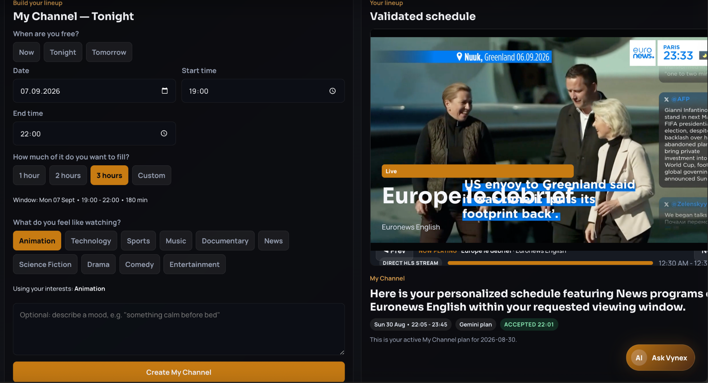
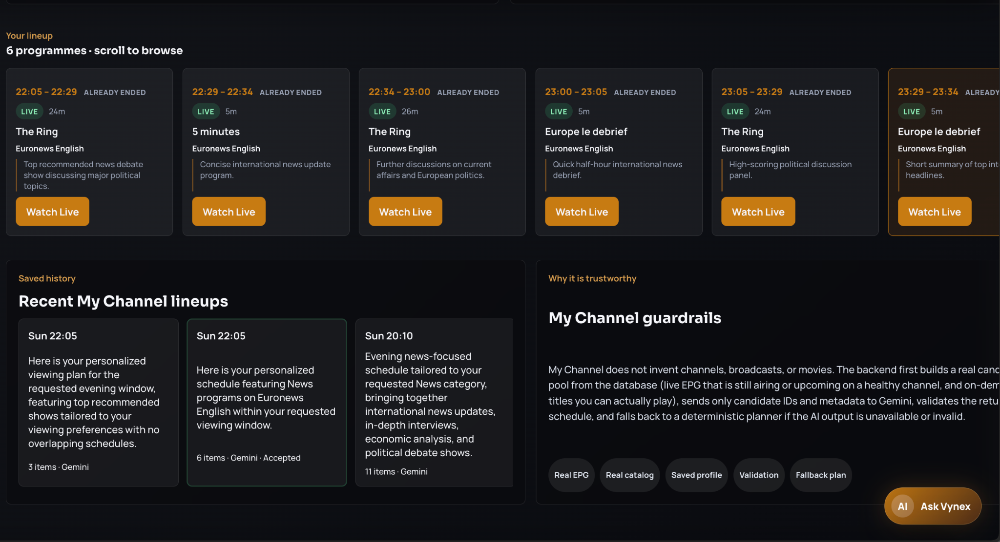
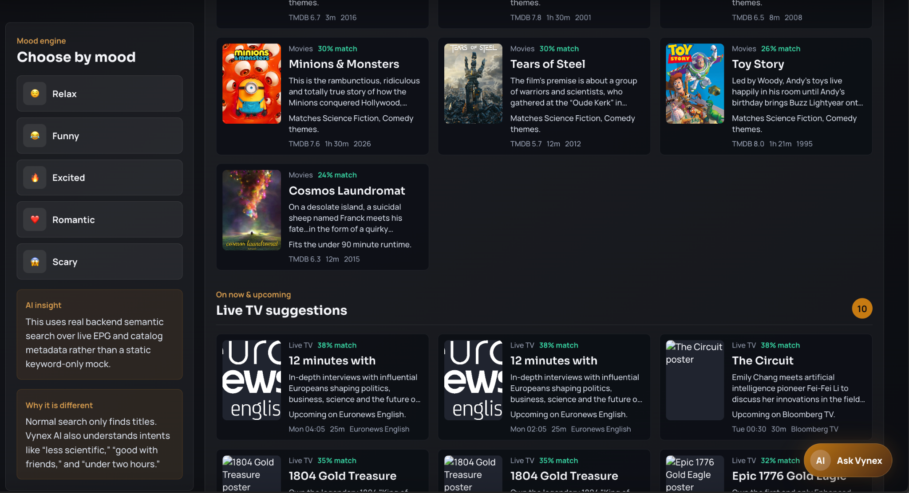
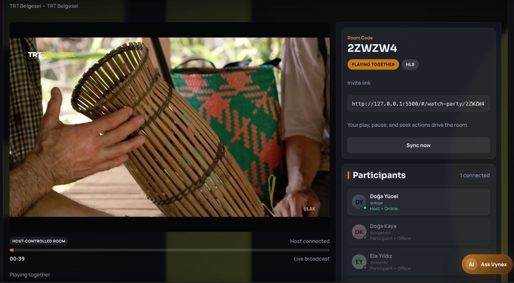
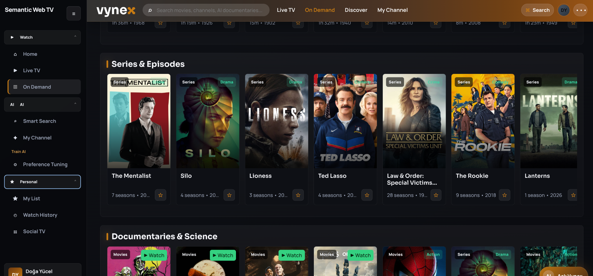
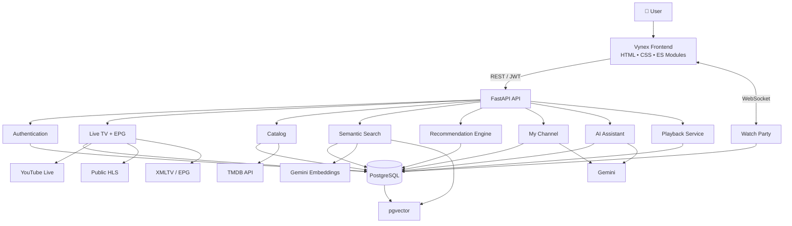

<div align="center">

# VYNE<span style="color:#d98600">X</span>

### Smart Semantic Web TV Platform

**Live television, real EPG data, semantic discovery, personalized AI scheduling,  
legal on-demand playback and synchronized watch parties — in one platform.**

<br>


</div>

---

<p align="center">
  
</p>

## What is Vynex?

**Vynex is an AI-powered television and streaming platform that combines live broadcasting and on-demand media into one personalized viewing experience.**

Instead of treating Live TV, movies, recommendations and AI as separate features, Vynex connects them.

The platform can understand what a user likes, inspect what is actually airing on television, search the on-demand catalog semantically, and build a personalized viewing schedule containing both **live broadcasts and VOD content**.

It also supports real-time synchronized viewing rooms, grounded AI assistance and a professional electronic programme guide.

> **The goal is not to build another Netflix clone.  
> The goal is to make television understand the viewer.**

---

# Highlights

<table>
<tr>
<td width="50%">

### 📡 Real Live TV

Public and official **HLS / YouTube Live** sources are normalized through the backend.

- Turkish & English channels
- Sports, News, Music, Youth and more
- Stream health validation
- Real channel logos
- Live/offline states
- Browser-safe playback

</td>
<td width="50%">

### 📅 Real EPG

A genuine Electronic Programme Guide powered by normalized external schedule data.

- 30-minute timeline
- Real programme durations
- Current-time indicator
- Channel logos
- NOW / upcoming states
- Date navigation
- Programme details

</td>
</tr>

<tr>
<td width="50%">

### 🧠 Semantic Discovery

Search by **meaning**, not only by title.

Vynex searches across both:

- Movies & series
- Live and upcoming EPG programmes

Queries such as:

> *"Something funny to watch with friends"*  
> *"Technology documentaries under two hours"*  
> *"Science content airing tonight"*

can be interpreted against real catalog metadata.

</td>
<td width="50%">

### ✨ My Channel

A Gemini-powered personalized scheduler that combines:

- User interests
- Favorites
- Watch history
- Real EPG availability
- Playable VOD
- Recommendation scores
- Selected time window

Gemini never invents content — it can only arrange candidates already validated by the backend.

</td>
</tr>

<tr>
<td width="50%">

### 👥 Watch Together

Create a room and watch with other users in real time.

- Shareable room codes
- Host-controlled playback
- Play / pause / seek synchronization
- Drift correction
- Participant presence
- Profile avatars
- Real-time persisted chat

</td>
<td width="50%">

### ▶️ Real Playback

Playback is separated from catalog metadata.

Supported adapters include:

- HLS
- MP4
- Official YouTube embeds
- Approved external embeds

Commercial catalog entries without a legitimate source are never falsely presented as streamable.

</td>
</tr>
</table>

---

# Live TV & Electronic Programme Guide

<p align="center">
  
</p>

Vynex does not populate its Live TV screen with static mock cards.

The backend maintains a curated set of real channels and normalizes multiple broadcast providers into a single playback contract.

The current catalog supports Turkish and international sources while intentionally rejecting streams that require DRM circumvention, authentication bypasses or unreliable third-party relays.

### TV Guide

<p align="center">
  
</p>

The EPG behaves like a real television guide:

- programme blocks scale according to their actual duration
- channels remain aligned against a shared timeline
- current programmes are detected using real time
- XMLTV / provider schedules are normalized into PostgreSQL
- missing schedules are displayed honestly as `Schedule unavailable`

No fictional schedule entries are generated by AI.

---

# My Channel — AI That Builds Your Evening

<p align="center">
  
  
</p>

The user chooses a real availability window:

```text
Date        07 September
Start       19:00
End         22:00
Interests   Animation, Technology, Sports...
```

Vynex then builds candidates from:

```text
                 USER PROFILE
                      │
          ┌───────────┼───────────┐
          │           │           │
      Interests   Favorites   Watch History
          │           │           │
          └───────────┬───────────┘
                      ▼
              Candidate Ranking
                 /          \
                /            \
          LIVE EPG          VOD Catalog
             │                  │
             └────────┬─────────┘
                      ▼
                    Gemini
                      ▼
             Validated Schedule
                      ▼
                 MY CHANNEL
```

The LLM is deliberately **not trusted as the source of truth**.

Before a generated plan is accepted, the backend verifies that:

- every content ID really exists
- live programmes really air at the specified time
- streams/content are available
- items do not overlap
- VOD durations fit the available window
- the model did not invent any programme or movie

If Gemini is unavailable, Vynex can fall back to a deterministic planner.

---

# Semantic Search & Mood Engine

<p align="center">
  
</p>

Traditional media search asks:

> **What title did the user type?**

Vynex asks:

> **What does the user actually want to watch?**

Catalog items and upcoming television programmes are transformed into semantic documents and indexed using embeddings.

The search layer combines:

- Gemini embeddings
- PostgreSQL + `pgvector`
- catalog metadata
- EPG metadata
- genres
- categories
- descriptions
- duration and availability

### Choose by Mood

Mood is not a decorative frontend filter.

Selecting **Relax**, **Funny**, **Excited**, **Romantic** or **Scary** modifies the semantic intent and ranking of real backend results.

---

# Watch Together

<p align="center">
  
</p>

Vynex includes a real-time social viewing layer built on **FastAPI WebSockets**.

The host owns the shared playback state while participants remain synchronized.

```text
                   WATCH ROOM
                       │
               Authoritative State
                       │
         ┌─────────────┼─────────────┐
         │             │             │
      Viewer A      Viewer B      Viewer C
         │             │             │
         └────── Real-time Chat ─────┘
```

### Room capabilities

- authenticated room membership
- host-controlled play / pause / seek
- reconnect synchronization
- drift correction
- online / offline presence
- user avatars
- persisted recent chat history
- room invite links

Local controls such as volume and fullscreen stay independent.

---

# On Demand

<p align="center">
  
</p>

Movies and series use **real TMDB metadata**, including:

- posters and backdrops
- descriptions
- genres
- ratings
- runtime
- release information
- seasons and episodes
- official video metadata

TMDB remains a metadata provider only.

Actual playback sources are modeled independently to ensure that a catalog title is never treated as playable unless a legitimate source exists.

---

# Ask Vynex

Vynex also contains a context-aware AI assistant.

Unlike a generic chatbot, the assistant is grounded in the content currently being viewed.

The retrieval pipeline resolves trusted information from:

- catalog metadata
- EPG entries
- live channel metadata
- semantic search documents

Relevant context is retrieved **before** Gemini generates an answer.

```text
User Question
     │
     ▼
Current Content
     │
     ▼
Retrieval Service
     │
     ▼
Trusted Context
     │
     ▼
Gemini
     │
     ▼
Grounded Answer
```

If detailed context is unavailable, the assistant deliberately avoids pretending it knows transcript-level information.

---

# Architecture



---

# Backend Design

The backend follows a layered architecture rather than placing business logic directly inside API routes.

```text
backend/
├── alembic/                # Database migrations
├── app/
│   ├── api/
│   │   ├── deps/
│   │   └── routers/
│   ├── commands/           # Sync / maintenance commands
│   ├── core/               # Configuration & security
│   ├── db/
│   ├── models/
│   ├── repositories/
│   ├── schemas/
│   ├── services/
│   │   ├── assistant/
│   │   ├── catalog/
│   │   ├── epg/
│   │   ├── live_tv/
│   │   ├── llm/
│   │   ├── planner/
│   │   ├── playback/
│   │   ├── recommendations/
│   │   ├── search/
│   │   └── watch_party/
│   └── main.py
└── tests/
```

The separation allows external providers such as Gemini, TMDB, YouTube and XMLTV sources to be replaced without coupling them directly to the UI.

---

# Tech Stack

| Layer | Technology |
|---|---|
| Frontend | HTML5, CSS3, JavaScript ES Modules |
| Routing | Client-side hash routing |
| Backend | Python 3.12+, FastAPI |
| API Schemas | Pydantic |
| ORM | SQLAlchemy 2 |
| Database | PostgreSQL |
| Semantic Storage | pgvector |
| Migrations | Alembic |
| Authentication | JWT |
| AI / LLM | Google Gemini |
| Embeddings | Gemini Embeddings |
| Movie / TV Metadata | TMDB |
| Live TV | Public HLS + Official YouTube |
| EPG | XMLTV / provider schedules |
| Real-time | FastAPI WebSockets |
| Testing | Pytest |

---

# Getting Started

## Prerequisites

- Python **3.12+**
- PostgreSQL
- PostgreSQL `vector` extension
- TMDB API credentials
- Gemini API key
- YouTube Data API key for YouTube Live discovery

Clone the repository:

```bash
git clone https://github.com/dogaycl/Smart-Semantic-Web-TV.git
cd Smart-Semantic-Web-TV
```

Create the local environment file:

```bash
cp .env.example .env
```

Configure at least:

```env
DATABASE_URL=postgresql+psycopg://...
JWT_SECRET_KEY=...

TMDB_API_KEY=...
TMDB_ACCESS_TOKEN=...

GEMINI_API_KEY=...
YOUTUBE_API_KEY=...
```

> Never commit `.env` or real API credentials.

---

## Backend

Create the database:

```bash
createdb smart_semantic_web_tv
```

Install and run:

```bash
cd backend

python3 -m venv .venv
source .venv/bin/activate

pip install -e ".[dev]"

alembic upgrade head

uvicorn app.main:app --host 127.0.0.1 --port 8000
```

Swagger / OpenAPI:

```text
http://127.0.0.1:8000/docs
```

---

## Frontend

From the repository root:

```bash
python3 -m http.server 5500
```

Open:

```text
http://127.0.0.1:5500/#/login
```

---

# Syncing External Data

Live channel catalog:

```bash
cd backend
python -m app.commands.live_tv_sync sync-channels
```

Refresh channel health:

```bash
python -m app.commands.live_tv_sync refresh-live-status
```

Refresh EPG:

```bash
python -m app.commands.live_tv_sync sync-epg --window-hours 48
```

External provider availability can change over time, so Live TV intentionally exposes honest unavailable states rather than replacing failed streams with fake content.

---

# Testing

```bash
cd backend
source .venv/bin/activate

pytest -q
```

The test suite covers functionality including:

- authentication
- profile personalization
- catalog synchronization
- Live TV providers
- EPG parsing and timezone handling
- semantic search
- recommendation ranking
- Gemini planner validation
- deterministic AI fallbacks
- playback source resolution
- Watch Party authentication
- WebSocket room control
- synchronized playback
- chat
- provider failure handling

---

# Design Principles

### Real data over mock data

Live schedules, catalog metadata and AI candidates come from real backend sources.

### AI is not the database

Gemini can rank, organize and explain information — but it is not allowed to invent catalog entries or broadcast schedules.

### Graceful degradation

If Gemini, YouTube, TMDB or another provider temporarily fails, the application should fail explicitly or use deterministic fallbacks rather than silently returning fabricated data.

### Legal playback only

Vynex does not bypass DRM, subscriptions, authentication, CORS or geo restrictions to obtain media streams.

### Explainable recommendations

Core recommendation scoring remains deterministic and transparent instead of being delegated entirely to an LLM.

---

# Why Vynex?

Most streaming interfaces solve one problem:

> **"What can I watch here?"**

Vynex tries to answer a different one:

> **"Given what I like, what is actually available right now — and what should I watch next?"**

That means combining television schedules, on-demand content, semantic understanding, user behavior and real-time availability into a single experience.

---

<div align="center">

### Built as a Smart Semantic Web TV platform — evolved into a full-stack AI media experience.

**Live. Search. Personalize. Watch Together.**

<br>

⭐ If you find the architecture or idea interesting, consider starring the repository.

</div>
